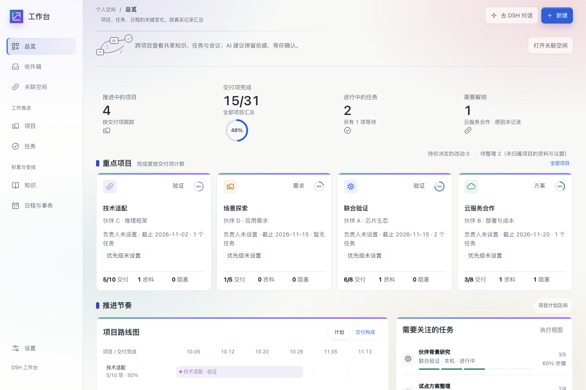
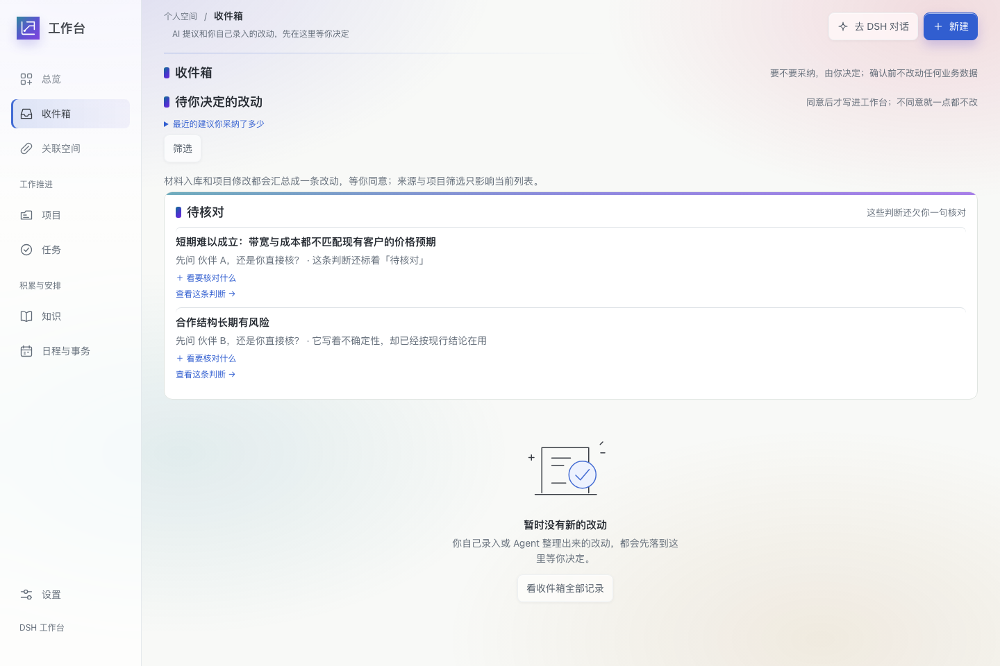
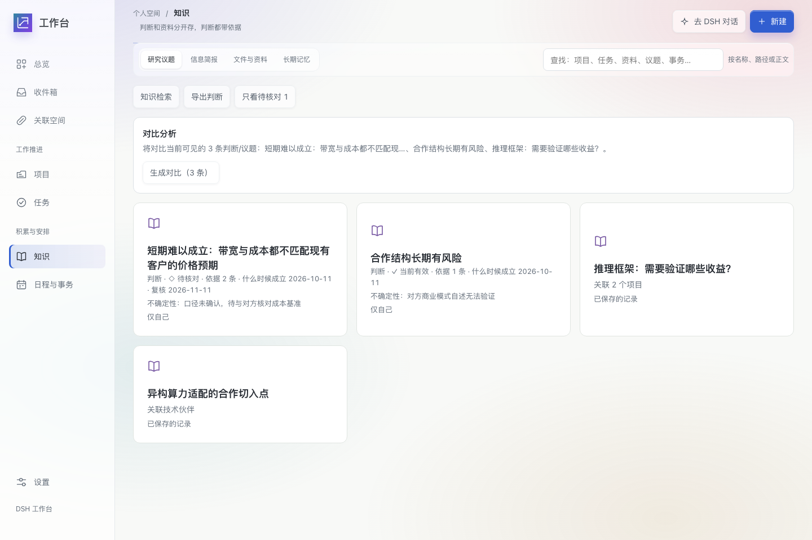

<div align="center">

# 个人工作台 · Personal Workstation

**给一个人的工作后台——项目、任务、材料、判断、关系，收在一张账上。**

[](LICENSE)
[](https://nodejs.org)
[](https://github.com/deepseek-ai/deepseek-harness)
[](#质量门禁)
[](CONTRIBUTING.md)

<sub>本地优先 · 数据在自己机器上 · AI 提议、人来定 —— 每条判断都留得出依据</sub>



</div>

---

## 这是什么

个人工作台是 [DeepSeek Harness](https://github.com/deepseek-ai/deepseek-harness)（DSH）的一个插件。
它把**项目、任务、资料、判断、日程与它们之间的关系**放进同一个页面，数据存在本机 SQLite 里，
默认不经过任何第三方服务器。

它解决的不是"让 AI 多干活"，而是另一件事：

> **让一个人不用再记那么多，却一次都没少负责。**

具体说，它把"人和 AI 一起改同一批资料"这件事拆成三条硬规则：

1. **AI 不偷偷改你的数据。** Agent 或你自己录入的改动，先落成收件箱里的一条待决定项，同意才写进去。
2. **判断是一等公民。** 每条结论必须带依据出处、什么时候成立、当前状态、不确定性；可以被推翻，推翻要留痕。
3. **一切可撤销。** 每次写入都有回执与「撤销」，断网时草稿保留，重试复用同一次请求。

---

## 六个界面

| 界面 | 它管什么 |
|---|---|
| **总览** | 项目、交付项、任务、日程的真实统计；点数字就地弹窗看那一组对象 |
| **收件箱** | 待你决定的改动、待核对的判断、以及「等你一句话」的输入 |
| **项目 / 任务** | 阶段、交付项、步骤、截止；项目文件夹里的材料可关联；字段就地编辑 |
| **知识** | 判断、研究议题、情报简报、文件与资料、长期记忆；判断可核对 / 可推翻 / 可导出 |
| **关联空间** | 无限画布：项目、任务、知识、事务与跨项目共享关系；AI 只提候选，确认由你决定 |
| **日程与事务** | 日程、事务、循环安排；与系统日历双向同步 |

<div align="center">

| 收件箱 · 每一笔改动等你点头 | 知识 · 判断带依据与有效期 |
|---|---|
|  |  |

</div>

---

## 设计原则

- **本地优先。** 业务对象在一个 SQLite 文件里，材料留在你自己的目录；多端是**对等副本**，不是主从。
- **人是决定者。** 有风险、对外、AI 触发 → 先确认；自己点的操作 → 直接生效 + 可撤销。界面一律说人话，不出现「批次 / 回执 / 幂等」这类内部词（这条有门禁）。
- **判断要能被质疑。** 依据分「对方自述」与「经第三方验证」；判断有有效期；推翻后旧判断仍在，理由也在。
- **AI 只提候选。** 画布上实线是明确关系、虚线是 AI 候选待确认，候选从不自动变成事实。
- **少占注意力。** 到点才说话；没内容就不发；发不出去如实说，不假装成功。

---

## 和 DeepSeek Super-agent 是什么关系

两边都长在 DSH 上，都在回答同一个问题：**人的注意力是瓶颈**。区别在盯的对象不同。

| | **DeepSeek Super-agent**（2026-10 开源原型） | **个人工作台**（本项目） |
|---|---|---|
| 面向 | 一个**代码仓库** + IM 群里的多人需求 | 一个人的**全部工作**：项目 / 任务 / 材料 / 判断 |
| 核心动作 | Router 分派、Worker 并行执行、回原对话交 PR | 接住 → 着落 → 判断 → 到点开口，全部留成可查记录 |
| 人的位置 | 提需求、验收 PR | **决定每一条改动**（收件箱）+ 核对每一条判断 |
| 状态与连续性 | 会话级：上下文缓存、订阅直通 | **账本级**：对象有版本、判断有依据、关系有确认状态 |
| 主动性的边界 | 事件触发（群消息 / CI / 评论） | 定时开口（09:30 / 21:00）+ 超期扫描；没内容不说话 |
| 数据在哪 | 代码在用户机器，会话状态独立存 | 全部业务数据在本机 SQLite，多端对等同步 |
| 输出形态 | Pull Request、群消息 | 结构化对象 + 可推翻的判断 + 画布关系 |
| 一句话 | **把「多会话并行」做到极致** | **把「个人知识的账」记清楚，每笔可追溯** |

可以互相借鉴、也已经照着做的四件事：

- **双层分工**：Super-agent 的 Router / Worker 分离，对应这里「判断层（纯函数、可回测）/ 投递层（有副作用、会失败）」的分离。
- **两级过滤**：它用程序层 + 语义层筛事件；这里用「三问」筛——**变了什么 / 意味着什么 / 能做什么**，三问答不全就不打扰你。
- **存算分离 + 看门狗**：它把会话状态与计算分开并外挂 Watchdog；这里把数据与执行分开，并在常驻节点上配心跳与自动重拉（心跳 15 分钟一次，掉线 45 分钟报警）。
- **少占注意力**：它的原则是「尽可能少占用人的注意力」，这里落到「没内容不发、发失败如实说、同日不重复开口」。

**差异化**：Super-agent 优化**吞吐与并行**，个人工作台优化**可信度与可追溯**——
三个月后回头看，你能知道当时为什么这么判断、依据是什么、谁改的、能不能推翻。

---

## 架构

```
┌──────────────────────────── 界面 ────────────────────────────┐
│ 总览 · 收件箱 · 项目 · 任务 · 知识 · 关联空间 · 日程           │
└───────────────▲──────────────────────────────▲───────────────┘
                │ 同一套 API（本机鉴权）        │
┌───────────────┴───────────────┐  ┌───────────┴──────────────┐
│ 业务层：对象模型 + 批次/回执   │  │ 助理层：收件本 / 着落本  │
│ 版本冲突重放 · 撤销 · 审计     │  │ 判断三问 · 开口 · 投递   │
└───────────────▲───────────────┘  └───────────▲──────────────┘
                │                              │
        ┌───────┴────────┐            ┌────────┴─────────┐
        │ 本机 SQLite    │            │ 心跳 / 定时 / IM │
        │ （业务对象）   │            │ （常驻节点）     │
        └────────────────┘            └──────────────────┘
```

- **前端**：DSH 内嵌 Web UI，视觉走 Paper Glass 体系（`design-system/`）。
- **存储**：`node:sqlite`（WAL），一份库跟一个根目录走。
- **多端**：对等副本，冲突按版本 + 时间裁定；代码只走 git，同步只搬数据。
- **助理**：常驻节点每 15 分钟写心跳，09:30 / 21:00 各开一次口；投递失败如实降级。

---

## 快速开始

```bash
# 0. 环境：DSH 桌面端 + Node ≥ 22.12
git clone https://github.com/simmon-clap/dsh-personal-workstation.git
cd dsh-personal-workstation

# 1. 依赖与测试
npm install
npm test

# 2. 装进 DSH 本机 profile
npm run install:local
# 然后完全退出 DSH 再打开

# 3. 在 DSH 里打开 /personal-workstation
```

完整步骤（配置、双端部署、同步）见 [`docs/RELEASING.md`](docs/RELEASING.md)。

---

## 质量门禁

这个项目对「完成」的定义是七关：依据 → 设计 → 实现 → 语义门禁 → 真实用户路径 → 证据账本 → 发布回滚。
所以仓库里有一堆看起来"多余"的检查，每一条都是被真实事故换来的：

```bash
npm test          # 911 个测试
npm run verify    # 文案禁用内部术语 / 视觉令牌 / 组件签名 / 规范覆盖 / 像素棘轮 / 常驻心跳
```

几条已经固化成门禁的教训：

- 界面文案出现「批次 / 回执 / 幂等」这类内部词 → 直接红（`prototype/wording-audit.mjs`）。
- 给配置加键却忘了同步白名单 → 整个插件启用失败（`test/plugin-activation.test.mjs`）。
- 工具返回值里含 `undefined` → 宿主整次拒收（`test/output-lossless.test.mjs`）。
- 门禁读到旧产物、或把「没测到」当「通过」 → 一律按 P0 处理。

---

## 欢迎 PR

非常欢迎。尤其这几类：

- **新的输入口**：邮件、日历、语音、笔记工具、表单……只要能落成结构化对象 + 判断。
- **新的判断规则**：你希望"到点它该提醒我什么"，写清楚三问，我们把它做成可回测的纯函数。
- **新的视图**：同一份数据换个角度看。
- **视觉与可访问性**：Paper Glass 体系还能更细。
- **文档与翻译**：中英双语文档都缺人。

提 PR 前请读 [`CONTRIBUTING.md`](CONTRIBUTING.md)，并说明：**依据**（哪条规范 / 哪个真实场景）、**改了什么**、**怎么验证的**（截图或测试）。
跑通 `npm test` 与 `npm run verify` 是最低门槛。

---

## 业务数据门禁

这个仓库是公开的，**任何真实客户名、内部研究数据、验收证据、数据库文件、家目录路径都不允许提交**。

```bash
npm run guard:public   # 已在 npm run verify 第一位；pre-commit 也会跑
```

词表放在仓库之外（`~/.dsh/private/business-terms.txt`），**缺词表时门禁直接失败**——"没有词表就放行"本身就是漏洞。详见 [docs/PUBLISHING.md](docs/PUBLISHING.md)。

## 许可

[MIT](LICENSE) · 用、改、商用都可以，出问题不担保。
